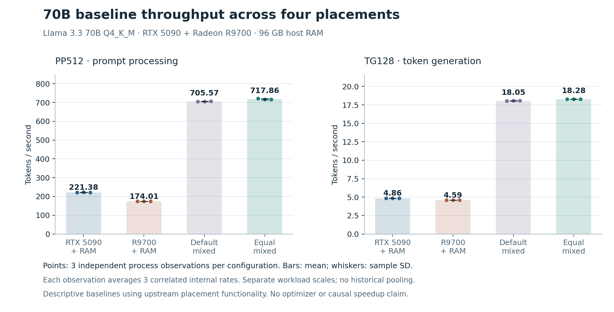
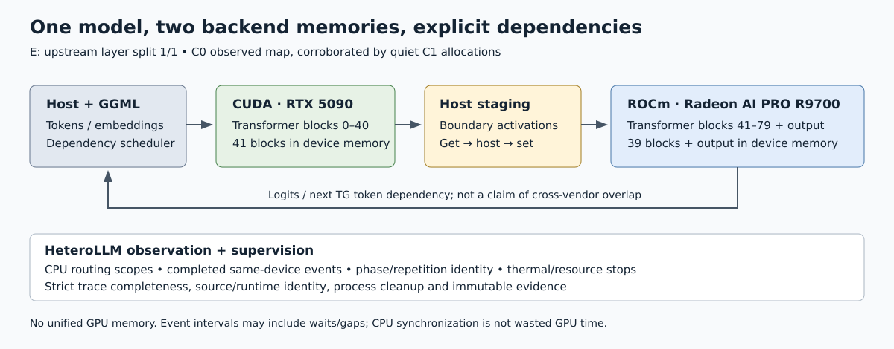

# HeteroLLM

### Measuring 70B inference across NVIDIA and AMD GPUs

**Python · C++ · Linux · CUDA · ROCm · llama.cpp**

A 42.52 GB model could not fit on either of my 32 GB GPUs alone. I used llama.cpp to split it across an RTX 5090 and a Radeon AI PRO R9700, then built the tooling to measure what happened: a process supervisor, bounded C++ instrumentation, and strict analysis of the resulting evidence.

The most useful fix was in the measurement system itself. The first recorder filled with frequent event calls and **dropped 22,336 spans**, losing the transfer records I needed. I changed those calls to exact aggregates while retaining detailed routing spans. The follow-up diagnostic captured **5,222 detailed spans and 82,650 aggregated calls with zero drops**.

[Results](#measured-results) · [Code tour](#start-with-the-code) · [Offline demo](#run-the-offline-demo) · [Case study](docs/CASE_STUDY.md) · [Resume entry](docs/RESUME.md)

## What I built

| Component | Engineering work | Evidence |
|---|---|---|
| Trace recorder | Separate high-frequency event aggregates from detailed copies and graph calls; reject incomplete captures | Zero-loss follow-up diagnostic; concurrent fixture with 100,000 aggregate calls and 900 detailed records |
| Experiment supervisor | Gate child launch on resource checks; bound monitoring and runtime; terminate owned process groups and retain failure records | Synthetic sensor, timeout, cleanup, and failure-path tests |
| Validation and analysis | Compare fixed-input outputs, calculate overhead from paired processes, and keep independent launches separate from internal repeats | 16.5M byte-identical logits; six paired overhead blocks; 12 baseline launches |

llama.cpp supplies inference, model loading, kernels, layer placement, and scheduling. This project's contributions are instrumentation, supervision, validation, and analysis. The [contribution map](docs/CONTRIBUTIONS.md) records that boundary and the AI-assisted development workflow.

## Measured results

Llama 3.3 70B Instruct Q4_K_M; one workstation with 96 GB host RAM.

| Configuration | Prompt processing, PP512 (tokens/s) | Generation, TG128 (tokens/s) |
|---|---:|---:|
| RTX 5090 + CPU/RAM | 221.377 ± 0.666 | 4.8582 ± 0.0067 |
| R9700 + CPU/RAM | 174.012 ± 0.103 | 4.5937 ± 0.0050 |
| Default mixed | 705.573 ± 0.919 | 18.0517 ± 0.0302 |
| Equal mixed | **717.858 ± 2.809** | **18.2823 ± 0.0065** |

Mean ± sample standard deviation across three independent processes per configuration, 12 launches total. PP512 and depth-zero TG128 are separate workloads; each process contains three correlated repeats per workload.



Equal mixed measured 3.76× the generation throughput of the NVIDIA + CPU-offload configuration. Both GPU memory capacity and placement differ between these configurations. This is a deployment comparison; it does not measure a new kernel or scheduler optimization.

**The observer was checked separately.** Original and instrumented runtimes produced byte-identical results for 16,545,024 float32 logits at 129 fixed positions with the same placement. Six counterbalanced run pairs estimated generation elapsed-time overhead at **0.605%** (nominal 95% paired interval: 0.240%–0.972%). Prompt-processing overhead was 0.108% (−0.497%–0.716%). These checks apply to the tested fixture and workload.

[Full results and limitations](docs/RESULTS.md) · [Integer timing samples](evidence/portfolio/raw-timings.json) · [Statistical method](docs/METHODOLOGY.md)

## How execution is arranged



The equal split places transformer blocks 0–40 on CUDA, then blocks 41–79 and the output layer on ROCm. Each GPU has separate allocations. The diagnostic recorded 137 host-staged cross-vendor copies carrying 36.03 MiB of logical tensor data across the captured process, including warmup. Those bytes are not a physical PCIe traffic measurement.

[Architecture and upstream source references](docs/ARCHITECTURE.md)

## Start with the code

| Read | What to look for |
|---|---|
| [C++ recorder](instrumentation/v2/heterollm-cpu-trace.h) and [v2 GGML patch](instrumentation/v2/ggml-cpu-trace.patch) | Bounded detailed storage, exact aggregates, mutex-protected counters, and completion records |
| [Trace analyzer](heterollm/trace_analysis.py) | Rejection of loss, unfinished records, malformed metadata, and inconsistent counters |
| [Process supervisor](heterollm/supervisor.py) | Gated child launch, bounded sampling, durable stop intent, and process-group cleanup |
| [Paired calibration](heterollm/calibration_analysis.py) | Process-level elapsed ratios, paired uncertainty, and order effects |
| [Recorder fixtures](tests/test_c2_trace_v2.py) and [data checks](tests/test_portfolio_data.py) | Concurrent aggregation and reproduction of reported statistics |

## Run the offline demo

Python 3.10+; no model, GPU, package installation, or network access:

```bash
python3 scripts/demo.py
```

The demo recalculates the reported baseline and overhead summaries from the bundled integer timings. It does not generate new performance measurements.

On Linux, run the portable analysis fixtures and optional C++17 recorder checks:

```bash
bash scripts/test-offline.sh
bash scripts/test-recorder-cpu.sh
```

The broader `bash scripts/test-cpu.sh` suite exercises host supervision and additionally requires readable Linux procfs and memory-pressure telemetry (`/proc/pressure/memory`). The supplied workstation audit recorded 205 passing tests and one expected private-archive skip; that is a historical host result. See [current verification](docs/VERIFICATION.md) for the checks completed during portfolio preparation and the cloud-container limitation.

## Portfolio and GitHub

The responsive project page lives in [site/](site/). Build an offline copy, including its source download and evidence links:

```bash
python3 scripts/build-portfolio.py
```

Open `dist/index.html`. The repository includes CPU CI, a manually triggered GitHub Pages workflow, and a private-repository setup script. [GitHub setup](docs/PUBLISH.md) covers the short account-dependent step. Public release remains deferred at the owner's request.

## Research status

The baseline and measurement work is complete within the scope above. A later CUDA-heavier placement candidate did not pass the frozen numerical check, and its exploratory quality retry was incomplete. A validated placement optimization remains open. The [status report](docs/STATUS_REPORT.md) and [engineering journey](docs/ENGINEERING_JOURNEY.md) retain the unsuccessful attempts and decisions.

The export contains project source, patches, tests, documentation, charts, and compact evidence. Model weights, GPU SDKs, compiled upstream runtimes, and private raw archives are separate. Original contributions use [MIT](LICENSE); upstream and font notices are retained in [NOTICE.md](NOTICE.md).
