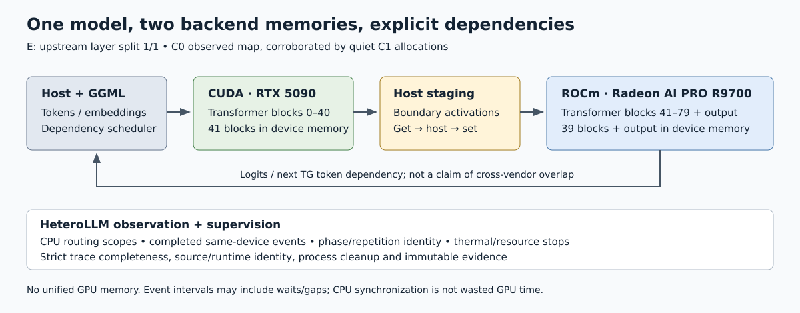
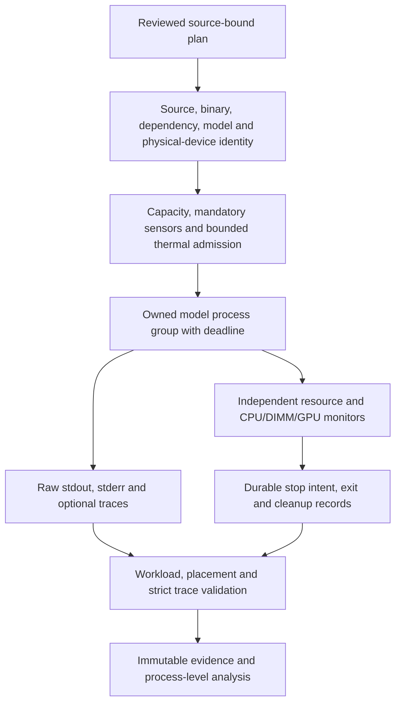

# Execution and measurement architecture

HeteroLLM is a Python experiment/analysis package around pinned llama.cpp `5e03bdd8700948b9c41c54dd1b00f28a2aebc03f`. The original C1 runtime is frozen. Optional C2 recorder/timing patches were built in separate trees; neither is an optimized inference engine.

## Model execution

The [Mermaid source](assets/layer-execution.mmd) is editable diagram-as-code. Boxes describe dependencies and ownership, not simultaneous kernel activity or physical interconnect topology.

| Arm | CPU transformer blocks | CUDA transformer blocks | ROCm transformer blocks | Output layer 80 |
|---|---|---|---|---|
| A — CUDA + RAM | 0–24 | 25–79 | — | CUDA |
| B — ROCm + RAM | 0–21 | — | 22–79 | ROCm |
| D — default mixed | — | 0–39 | 40–79 | ROCm |
| E — explicit 1:1 | — | 0–40 | 41–79 | ROCm |

These maps were observed in verbose C0 diagnostics and corroborated by C1 buffer/activity checks. Quiet timed C1 did not produce new per-layer traces. CPU embeddings and some non-layer tensors/work remain even when every transformer block is on a GPU. Device allocations are separate; there is no unified 64 GB GPU memory pool.

The E C2 model-buffer logs report CUDA 20,038.81 MiB, ROCm 19,940.67 MiB and CUDA_Host 563.62 MiB. Those are model buffers, not total device consumption. KV, compute buffers and background processes add memory; admission therefore uses observed available VRAM and reserves.

Pinned scheduler behavior is explicit: a cross-family async-copy callback can refuse the foreign buffer; the scheduler then observes producer readiness and protects the destination slot before the generic `malloc → get → set → free` host-stage path. CUDA/HIP backend recognition depends on backend-local implementation identity, not different GUID text. See pinned [scheduler](https://github.com/ggml-org/llama.cpp/blob/5e03bdd8700948b9c41c54dd1b00f28a2aebc03f/ggml/src/ggml-backend.cpp#L1938), [copy fallback](https://github.com/ggml-org/llama.cpp/blob/5e03bdd8700948b9c41c54dd1b00f28a2aebc03f/ggml/src/ggml-backend.cpp#L628), and [CUDA/HIP callback](https://github.com/ggml-org/llama.cpp/blob/5e03bdd8700948b9c41c54dd1b00f28a2aebc03f/ggml/src/ggml-cuda/ggml-cuda.cu#L2544).

## Supervision and evidence

| Component | Responsibility |
|---|---|
| `heterollm/gguf.py`, `planner.py` | Tensor-directory accounting and capacity-screened contiguous placements; estimates must be checked against runtime allocations |
| `hardware.py`, `gpu_sensors.py`, `host_thermal.py` | Physical identity, mandatory readings, bounded AMD sensor readiness, CPU/DIMM monitoring |
| `supervisor.py` | Process ownership, time/resource stops, durable evidence, streamed loader guard, cleanup and exception traceback |
| `stage_c*.py` | Fixed experiment contracts and stage-specific acceptance; fresh checks before each launch |
| `trace_analysis.py`, `timing_analysis.py`, `calibration_analysis.py` | Strict trace schema/completeness, matched timing scopes and independent-pair analysis |
| `instrumentation/v2`, `instrumentation/v3` | Optional routing/aggregate recorder and phase/completed-event observation |

File names above are source navigation; stage adapters retain host-specific contracts and are not a universal hardware service. The current public configuration is a portable example, not an approved execution manifest.

## Timing semantics

The CPU recorder uses one host monotonic clock for routing and callback intervals. Frequent event bookkeeping is aggregated with exact counts, total/max CPU-call duration and bounded histograms; detailed copy/graph records retain required identities. An unexpected loss, malformed scope, missing footer, write failure or error marker invalidates capture even if inference exits zero. Zero host-stage fallbacks can be a valid complete negative result.

The v3 recorder distinguishes PP warmup, measured PP, TG warmup and measured TG, with repetition identity. Native CUDA/HIP events establish completed intervals on the same device stream. Completion is harvested without adding waits solely to collect timestamps. Host-clock enqueue/completion enclosures support ordering with uncertainty; timestamps from independent device clock domains are never directly subtracted.

Graph-stream duration can include waits/gaps and is not kernel-only execution. CPU synchronization can wait for legitimate GPU work and is not wasted GPU time. Nested scopes overlap; their durations cannot form an additive wall-time budget. Logical tensor bytes are not measured PCIe traffic.

Buffered trace records can be lost on abrupt termination. Missing complete terminal evidence fails validation; independent supervisor samples, stop intent, traceback, process status and cleanup evidence remain the durable failure record. Sampling does not certify continuous physical maxima. A write I/O failure is a failed evidence capture, not a usable result.

## Preserved safety contract

Later C2 supervision retains 32 GiB child RSS/HWM, 40 GiB available RAM at admission, 4 GiB runtime available-RAM floor, 256 MiB cumulative swap-growth stop and per-device capacity checks with a 3 GiB planning reserve. GPU admission requires at least 30 seconds cooling and both GPUs ≤45°C for 10 seconds across 11 fresh readings, bounded at 600 seconds; runtime GPU stop is 85°C.

CPU admission requires readings below 90°C. Runtime policy uses 95°C Tjmax: warning at 90°C, a sustained episode beginning at 95°C and resetting at or below 93°C, a 25-second episode stop, and immediate stop above 95°C or on a critical alarm. Provisional DIMM SPD-hub policy warns at 55°C, stops sustained 60°C for 25 seconds or immediately at 65°C/critical alarm, with 2°C hysteresis and independent timers. Sticky high alarms alone are warnings. Missing/invalid mandatory evidence fails closed. No threshold registers, power-management settings or drivers are altered.

C1 predates CPU/DIMM thermal monitoring; those historical temperatures are unknown. The nominal 96 GB RAM configuration was not formally stability-certified. These limitations remain part of the record.
