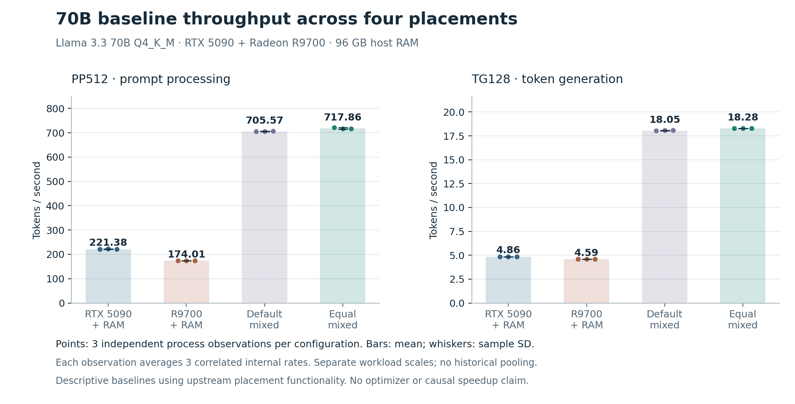

# HeteroLLM: making mixed-GPU inference measurable

**Jae · Systems engineering project · 2026**  
Python, C++, Linux, CUDA, ROCm, llama.cpp

## The problem

The 42.52 GB Llama 3.3 70B Q4_K_M model exceeded the capacity of either 32 GB GPU in my workstation. llama.cpp could distribute its layers across the NVIDIA RTX 5090 and AMD Radeon AI PRO R9700. The engineering question was how to measure that execution without mistaking missing traces, nested waits, or a different memory placement for an optimization.

I built the experiment controller, instrumentation, and analysis around the pinned runtime. The work combines low-level C++ recording with Python process control and reproducible measurement. Model loading, inference kernels, layer placement, and scheduling come from llama.cpp.

## The bug that shaped the project

The first bounded recorder had 65,536 slots. Frequent event bookkeeping filled them and dropped another 22,336 spans. The workload finished, but no copy records survived. A larger buffer would consume more memory while still storing frequent bookkeeping calls as individual records.

I changed the recording policy at two GGML call sites. Frequent event records and synchronizations became exact per-backend aggregates, retaining counts, duration totals, maxima, and histograms. Transfers, graph submissions, and routing waits kept detailed spans. The analyzer rejects captures with dropped or unfinished records, overflow, or inconsistent counters.

The accepted follow-up contained 5,222 detailed spans and 82,650 aggregated event calls, with zero losses. It exposed 137 CUDA → host → ROCm staging operations carrying 36.03 MiB of logical tensor data. This was a complete routing diagnostic, including warmup, rather than a new throughput run. A CPU fixture separately exercises 100,000 concurrent aggregate calls interleaved with 900 detailed records.

[Recorder implementation](../instrumentation/v2/heterollm-cpu-trace.h) · [Patch](../instrumentation/v2/ggml-cpu-trace.patch) · [Strict analyzer](../heterollm/trace_analysis.py) · [Recorded evidence](../evidence/portfolio/recorder-summary.json)

## Checking the observer

A useful profiler must also be checked for what it changes. With the same placement and a fixed teacher-forced fixture, the original and instrumented runtimes produced byte-identical arrays of 16,545,024 float32 logits at 129 positions. Greedy token IDs and token-piece bytes also matched. This establishes agreement for that fixture; it does not establish general model-quality equivalence or equality across placements.

For cost, I used six paired process blocks with counterbalanced original/instrumented order. The phase-aware observer's estimated elapsed overhead was 0.605% for generation and 0.108% for prompt processing. The nominal 95% paired intervals were 0.240%–0.972% and −0.497%–0.716%, respectively. Internal repeats remained inside their process-level observations.

## Making experiments recoverable

The Python supervisor checks resources and sensors before releasing a gated child, bounds the monitoring work, and owns the benchmark's process group. Timeout, thermal, and memory stops preserve their reason and trigger cleanup. Failure records are retained instead of silently entering the successful benchmark sample.

These mechanisms matter because a partially completed experiment can otherwise leave children running or produce a result that looks valid while its telemetry is incomplete. Synthetic tests cover missing sensors, malformed inputs, bounded readers, deadlines, termination, and durable records.

[Supervisor](../heterollm/supervisor.py) · [Tests](../tests/test_supervisor.py)

## What the measurements show

Across 12 independent baseline launches, equal mixed placement measured 717.858 prompt tokens/s and 18.282 generation tokens/s. NVIDIA with CPU offload measured 221.377 and 4.858 tokens/s. These are means across three processes per configuration; PP512 and depth-zero TG128 are separate workloads.

The generation ratio is 3.76×, but the mixed configuration keeps transformer blocks on GPUs while the single-GPU configuration offloads some to CPU. The result demonstrates a useful deployment difference on this workstation. It does not isolate a new implementation speedup.

## The decision

The traces placed a longer ROCm region on the serial generation path, but its kernel-only composition and removable cost remained unknown. Much of a broad scheduler fallback interval was nested producer synchronization; treating all of it as copy overhead would double-count time and suggest the wrong optimization.

A later CUDA-heavier placement did not pass the frozen numerical check. The exploratory quality retry remained incomplete after a temperature stop. I kept those outcomes and did not promote the pilot timing into a validated speedup.

The completed result is an inspectable measurement workflow with a demonstrated recorder repair, fixed-input validation, calibrated overhead, and controlled baselines. The next research step would be a separately validated placement comparison once the workstation is reliable.

## Inspect or reproduce

- Run `python3 scripts/demo.py` to recompute the headline statistics from included integer timings.
- Read the [source contribution map](CONTRIBUTIONS.md) and [architecture](ARCHITECTURE.md).
- Use the [verification record](VERIFICATION.md) to distinguish historical host tests from current portable checks.
- Follow [reproduction](REPRODUCE.md) for the pinned runtime, model identity, and experiment prerequisites.

This project used AI-assisted development. The source and evidence distinguish the owner's experiment decisions, implementation assistance, upstream functionality, and the scope of artifact reviews.
