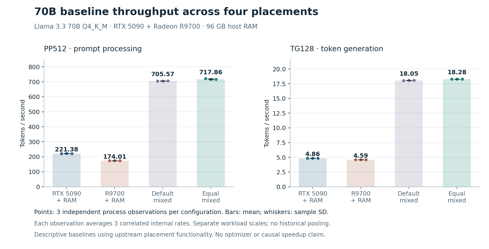
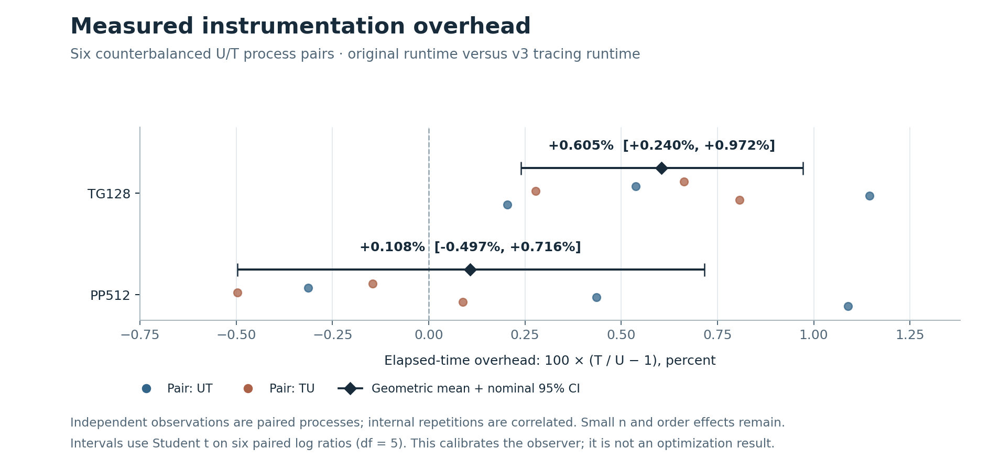
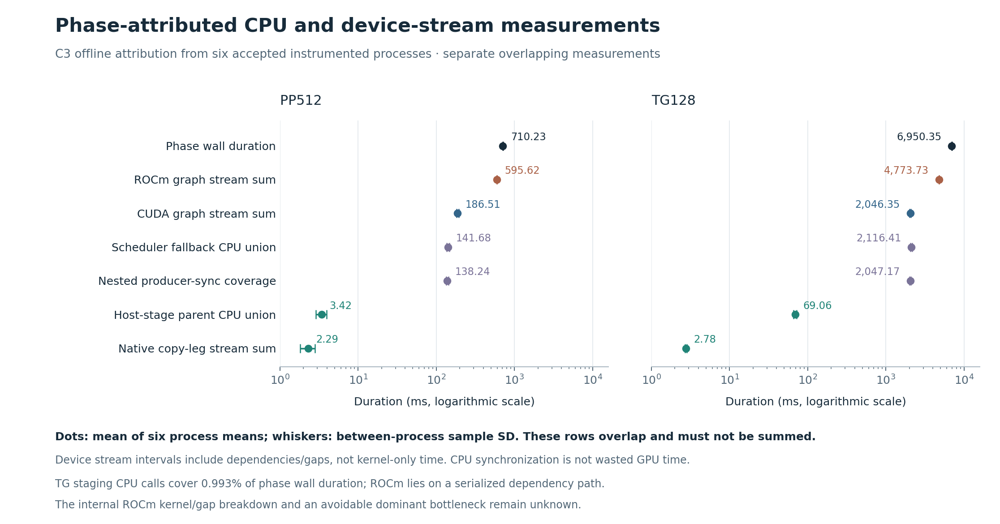

# Accepted results and their limits

This page preserves the accepted C1–C3 results and adds the research status through 3 November 2026. Original observations remain frozen. C1, C2 numerical agreement, C2 overhead, C3 attribution and C3.1 prior-art results received independent ChatGPT offline review of archived evidence. That review did not witness live hardware or independently measure continuous sensor maxima. C3.2 is a completed source/CPU NO-GO. New Codex-reported observations are distinguished below; public-release preparation is not a new GPU measurement.

## C1: four deployment configurations

| Arm | PP512 mean ± SD, tokens/s | TG128 mean ± SD, tokens/s |
|---|---:|---:|
| A — RTX 5090 + RAM | 221.376843 ± 0.666224 | 4.858205 ± 0.006669 |
| B — R9700 + RAM | 174.011605 ± 0.103344 | 4.593704 ± 0.005018 |
| D — default mixed | 705.573001 ± 0.918612 | 18.051690 ± 0.030208 |
| E — equal mixed | 717.858037 ± 2.809219 | 18.282255 ± 0.006454 |

Twelve independent processes in EDAB / DBEA / BADE order, three per arm. Each launch runs separate PP512 and depth-zero TG128 with three internal repetitions. The process statistic averages its three token rates; table SD is between process statistics. Frozen integer durations and process observations are retained in the private archive; sanitized public observations and source digests are in [data](../evidence/portfolio/README.md).

E/A throughput ratios are approximately 3.24× PP and 3.76× TG; E/B are 4.13× and 3.98×. The single-GPU arms offload 25 or 22 transformer blocks to CPU, whereas both mixed arms keep transformer blocks on GPUs. These are configuration comparisons, not isolated GPU compute controls or an original optimization gain. E exceeds D means by approximately 1.74% PP and 1.28% TG; small n, time/order effects and a one-block boundary difference limit generalization.

| Arm | Sampled child RSS, GiB | Device-wide CUDA / ROCm VRAM, GiB | Sampled CUDA / ROCm maximum °C |
|---|---:|---:|---:|
| A | 13.617 | 28.492 / 0.056 | 49 / 44 |
| B | 12.392 | 0.441 / 29.250 | 39 / 70 |
| D | 2.059 | 20.401 / 20.545 | 49 / 75 |
| E | 2.060 | 20.880 / 20.094 | 49 / 75 |

All are maxima across sampled observations of the three launches; VRAM includes background allocations. Sampled RSS is not the same quantity as sampled VmHWM or wait4 lifetime maximum RSS. Swap remained zero. C1 CPU/DIMM temperature histories were not collected. Earlier diagnostics and partial C1 attempts are not pooled here.

## C2: recorder reliability

The first routing diagnostic completed its model workloads but was invalid as a trace: all 65,536 slots filled, another 22,336 spans were dropped, and no copy/graph spans survived the repetitive low-level event traffic. The repaired recorder kept detailed routing/copy/graph spans and exact bounded event aggregates separately.

The accepted v2 capture contains **5,222 detailed spans, 82,650 aggregate event calls and zero unexpected losses**. It records 137 parent host-staging copies and 37,781,504 logical tensor bytes. Intentional aggregation is not dropped evidence; critical-span overflow or incomplete aggregates still invalidate the trace. These counts demonstrate a recorder reliability improvement, not physical PCIe throughput or faster inference.

## C2: correctness of the measurement observer

Original U and instrumented T produced **byte-identical** full-vocabulary float32 logit captures on the predeclared teacher-forced fixture: 129 × 128,256 = 16,545,024 finite values, 66,180,096 bytes per capture. Maximum absolute difference and RMSE were zero. All 129 greedy token IDs and token-piece bytes agreed. Acceptance was predeclared as absolute 1e−4 + relative 1e−5 against U, zero violations, exact greedy IDs/pieces; it was not adjusted after observation.

Both logit captures have SHA-256 `86fafdb06385b1605cc1bdd1361a4aff6106748d1ddc9dd7e99eb5f96b7c8e8d`. This establishes agreement for the tested fixed contexts and runtimes, not arbitrary autoregressive trajectories, model quality or general mathematical equivalence.

## C2: calibrated instrumentation overhead

| Endpoint | Geometric T/U elapsed overhead | Nominal 95% CI |
|---|---:|---:|
| PP512 | +0.108100% | −0.496609% to +0.716484% |
| TG128 | +0.605006% | +0.239675% to +0.971668% |

Six independent paired blocks in UT/TU/UT/TU/UT/TU order. Three internal repetitions are averaged within each process; six paired log-ratios yield a t interval with five degrees of freedom. All 72 original timing samples and six complete instrumented trace pairs were independently replayed. PP's interval spans zero and its order strata differ in sign. TG is positive in all six observed pairs. Temporal dependence, background/cache/thermal effects and two unadjusted endpoints constrain these small-sample intervals. These percentages calibrate the tested v3 observer, not a future vendor profiler; they must not be subtracted from individual event durations.

## C3: attribution without an invented speedup

Six T-process means place the TG phase at 6,950.354 ms and the ROCm graph-stream interval sum at 4,773.728 ms. Host-stage parent CPU coverage is 69.060 ms (0.993% of phase). The scheduler-fallback union of 2,116.412 ms contains 2,047.175 ms of nested producer synchronization. These scopes overlap; the chart is not a time-budget decomposition.

All 2,304 measured TG staging boundaries have host-observed CUDA completion before staging and ROCm submission afterward. All 2,286 within-repetition adjacent token pairs observe previous ROCm completion before next CUDA enqueue. PP ordering is established for only 18/54 adjacent pairs; 36 are unknown, not proof of overlap. PP has four 4 MiB staged requests per repetition; TG has 128 × 32 KiB. These are logical payload bytes, not physical bus traffic.

The evidence locates a credible longer ROCm region on the serial generation dependency path. Its kernel-only composition, internal waits/gaps, exact cross-vendor overlap and removable cost remain unknown. Graph replay is already active for measured TG on both GPUs. Source/prior-art inspection supplies no proven implementation-ready patch. A workload-aware placement policy remains a bounded hypothesis for C5; moving the boundary may help or regress performance.

## C3.2: completed NO-GO

CPU/source checks of the pinned ROCprofiler SDK identified loss-accounting, blocking and capacity problems incompatible with the proposed small adaptation. Required-domain typed-ring capacity alone was at least 33.5 MiB before SDK metadata, exceeding its 32 MiB collector contract; this is a capacity bound, not measured RSS. Small exact-source control-flow counterexamples are not an installed-GPU SDK reproduction. The route was stopped, with no new GPU profiler run and no rewrite of the failed or successful earlier traces.

## C5: screening, failed validation and unresolved quality

P moves the CUDA/ROCm boundary from E's 0–40 / 41–79+output to 0–48 / 49–79+output using upstream `--tensor-split 3/2`. The original runtime is unchanged.

| Experiment | Recorded outcome | Claim boundary |
|---|---|---|
| C5.2 P screening | PP512 **853.196306** and TG128 **20.286076** tokens/s; capacity and placement checks passed. | One process; approximately +18.85% PP and +10.96% TG against historical E are screening differences, not causal speedups. |
| C5.4 strict E/P comparison | **FAILED:** 16,448,640 elementwise tolerance violations; RMSE approximately 0.02156; 128/129 greedy predictions and token-piece bytes matched. | Frozen rule: `abs(P-E) <= 1e-4 + 1e-5*abs(E)`, with zero violations required. No tolerance was changed. The new E capture matched the accepted original-U C2 capture byte-for-byte. |
| R2 exploratory quality retry | Stopped before model execution on a DIMM sensor-path identity mismatch. | No E/P quality or performance observation. |
| R3 exploratory quality retry, 3 November | Codex-reported E load and partial execution; AMD junction **86°C** triggered the unchanged **85°C** stop. P did not launch; owned-process cleanup completed. | No complete E/P quality result. Fan **1,214 RPM**, sampled **0.096 seconds before** the maximum; no stall recorded. The thermal cause is unresolved. |

C5.4's differing greedy position was a near-tie. Counting logit entries outside a numerical tolerance is not a task-accuracy measure: values are correlated across positions and the vocabulary, and task behavior was not scored by that count. The result also does not establish that the differences are harmless. P's allocation-evidence matcher failed against historical medians even though its sampled peak did not exceed its earlier pilot peak; workload-dependent allocation and sampling prevent a universal median rule. Neither issue retroactively changes the failed outcome.

The exploratory quality result remains incomplete and the twelve-process controlled E/P performance plan remains **BLOCKED**. No automated optimizer, quality-equivalence finding or original inference speedup is complete.

## Scope

The accepted throughput comparison covers one workstation, one 70B quantization and two synthetic shapes; no serving-concurrency, long-context quality, energy or universal-speedup claim follows. An accepted measurement instrument and useful negative decisions are completed C4 contributions. The optimization objective remains open. The [historical C5 proposal](C5_PLACEMENT_PROPOSAL.md), [current decision](OPTIMIZATION_DECISION.md) and [methodology](METHODOLOGY.md) separate observations from outstanding claims.
